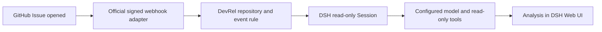

# Automatically triage newly opened GitHub Issues

This opt-in integration reuses DSH's official GitHub signature-verifying adapter
and webhook runtime. Our rule accepts `issues.opened` from an explicit repository
allowlist and requests one read-only Agent Session per matching delivery. The
model receives DevRel classification instructions and bounded Issue metadata.
Results appear in the Workspace's ordinary DSH Sessions, not in GitHub comments.



## 1. Start locally from this source checkout

Use Node 24 LTS (Node 22.18+ is also tested), Git and npm. Run the following from
the repository root. The bundled CLI and test dependencies use DSH **0.1.7-rc.2**.

```sh
npm ci
export DEVREL_GITHUB_REPOSITORIES='Mian-mian-hub/dsh-devrel-toolkit'
export DEVREL_WORKSPACE="$PWD"
export DEVREL_WEBHOOK_PORT=3081
export DSH_GITHUB_WEBHOOK_SECRET="$(openssl rand -hex 32)"
npm run start:issues
```

Keep the same secret for GitHub and the service across restarts. Store it in your
local secret manager or deployment environment; do not commit it, paste it into
an Issue, or put it in the Payload URL. `.env.example` only documents variable
names; it is not a real credential. Exported variables are sufficient; copying
the example does not automatically load it.

Open the URL printed by DSH (normally port 3080). Configure a working model in
Settings → Models. The rule uses DSH's current default model, the `standard`
Agent preset, and a fixed `read-only` permission preset. It does not require or
change the original `analyze_feedback` tool. No nested classification LLM is
called from that tool; the newly created Agent does the semantic analysis.

The listener binds to `127.0.0.1:3081`, independently of the Web UI on 3080. Add
`-- --no-open` to `npm run start:issues` to suppress opening a browser.
`DEVREL_WORKSPACE` must be an existing absolute local directory. This first
version routes every allowlisted repository to that Workspace; choose a
dedicated Workspace when inspecting multiple projects.

## 2. Exercise the trigger before configuring GitHub

In another terminal, export the SAME repository, secret and port values, then:

```sh
npm run demo:issue
```

This sends one signed synthetic `issues.opened` request to localhost. It creates
no real GitHub Issue, but it does request a model-backed Session and can consume
model tokens. The sample clearly says it is synthetic. Look for a Session titled
`Triage <owner/repository>#1: [LOCAL TEST] ...` under the configured Workspace.
The command prints the delivery ID so you can correlate it with Session metadata.

HTTP `202` means the event was accepted in memory, not that a rule matched or the
model completed successfully. Check the Session and startup/server diagnostics.
`401` means an invalid signature; `503` can mean the secret/provider is unavailable.
A newly created GitHub webhook's `ping` event is accepted but creates no Session.

## 3. Give GitHub a public HTTPS endpoint

GitHub cannot reach `localhost` on your computer. Forward a public HTTPS URL to
the dedicated listener, using a reverse proxy or a development tunnel. For a
local demonstration with an already installed `cloudflared`:

```sh
cloudflared tunnel --url http://127.0.0.1:3081
```

Use the HTTPS hostname it prints plus `/github`, for example
`https://<your-tunnel-host>/github`. Tunnel hostnames can change between runs;
update GitHub's Payload URL accordingly. Keep DSH and the tunnel running.
For continuous monitoring, deploy the service on an always-on host with a stable
HTTPS URL. Pushing this code to GitHub does not run that service.

## 4. Configure the TARGET repository's webhook

The webhook belongs to the repository whose Issues you want to monitor, not
necessarily the repository hosting this plugin. For example, to monitor
`Mian-mian-hub/dsh-devrel-toolkit`, configure:

`https://github.com/Mian-mian-hub/dsh-devrel-toolkit/settings/hooks`

Choose Settings → Webhooks → Add webhook:

| Field | Value |
| --- | --- |
| Payload URL | Your public HTTPS URL ending in `/github` |
| Content type | `application/json` |
| Secret | The exact value in `DSH_GITHUB_WEBHOOK_SECRET` on the service |
| Events | Let me select individual events → **Issues** |
| SSL verification | Enabled |
| Active | Enabled |

Repository owner/admin access is required. You can do this manually in GitHub,
or automate it with the repository-webhooks API after the real URL and secret
are ready. The integration does not create or modify remote webhooks itself.
For multiple repositories, configure a webhook in each and add each name to the
comma-separated `DEVREL_GITHUB_REPOSITORIES` allowlist. If you cannot administer
a target repository, use a polling/API integration instead; this receiver cannot
subscribe to someone else's repository by itself.

Open a real test Issue. In Settings → Webhooks → Recent Deliveries, find the
`issues` delivery and compare its delivery ID with the new DSH Session's webhook
message source. A `202` delivery with no Session can simply mean the repository
is not allowlisted or the action was not `opened`.

## Installed-bundle deployment

Install the toolkit from GitHub as described in the main README. Install the two
official peers into the same profile at the matching version:

```sh
dsh plugin --profile web add @deepseek-ai/dsh-webhook@0.1.7-rc.2 @deepseek-ai/dsh-webhook-github@0.1.7-rc.2
```

After exporting the environment from step 1, launch the overlay shipped in OUR
package (the official npm packages at this version omit their example files):

```sh
dsh web --patch "${DSH_HOME:-$HOME/.dsh}/profiles/web/node_modules/dsh-devrel-toolkit/examples/github-issues/cordis.yml"
```

The existing toolkit bundle still registers only its original analysis tool by
default. Webhook listening and automatic Agent creation require this explicit
overlay and configuration. Do not also load the source overlay in that profile.

## What this milestone guarantees

- Code filters repository, provider source, event type and action before creating
  a request, rejects malformed Issue fields, and bounds model-visible metadata.
- Official HMAC verification is reused. Issue text is passed as untrusted data;
  the model is instructed to distinguish observations, hypotheses and evidence.
- The prompt requests versioned JSON classifications, but model output is NOT
  schema-validated by this integration yet. Answers live in DSH Session history;
  there is no separate analytics database or GitHub write-back.
- This inherits the official runtime's process-local, fire-and-forget delivery
  semantics. There is NO durable task queue, replay recovery, or deduplication.
  Redelivering an event can create another Session; a crash before prompt admission
  can lose the job. Do not describe this demo as reliable exactly-once monitoring.
- New Issues only: no initial backfill, edited/reopened processing, comments, PRs
  or Discussions. Webhook authentication does not grant outbound GitHub access;
  private-repository evidence retrieval requires separately configured access.

## Verification

```sh
npm test
npm run test:bundle
```

The trigger integration test uses the REAL official signature handler and webhook
runtime, with in-memory HTTP request/response streams and fake Agent/model-facing
services. It checks invalid-signature rejection, ignored events, prompt admission
and plugin cleanup without requiring a network listener, credentials or an LLM
call. Packaged-file tests cover the compiled rule and shipped overlay. A live
model response and real GitHub delivery require the deployment setup above.

References: [DSH's official webhook review example](https://github.com/deepseek-ai/deepseek-harness/blob/master/docs/user/guide/github-review.md),
[GitHub repository webhook setup](https://docs.github.com/en/webhooks/using-webhooks/creating-webhooks).
