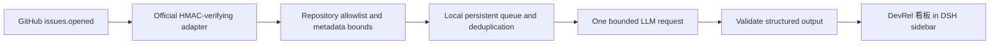

# GitHub Issues → DevRel sidebar dashboard



No Agent, chat Session, or conversational tool call is involved. The host plugin
reuses DSH's configured model and credential service. The native client plugin
registers a sidebar entry and main panel; list/detail/retry use DSH's authenticated
Remote gateway. Opening an ordinary conversation does not run the classifier.

## Local demonstration

Use Node 22.18+ (24 LTS recommended), Git and npm:

```sh
npm ci
npm run setup:issues -- Mian-mian-hub/dsh-devrel-toolkit
npm run start:issues
```

Open the URL printed by DSH, select **DevRel 看板**, and configure a model/provider
in Settings → Models. In a second terminal:

```sh
npm run demo:issue
```

The board updates every 2.5 seconds while open. The demo is explicitly labeled and
has no Issue number or GitHub Issue URL. The command sends a signed local fixture;
it does not create anything on GitHub. Each accepted fixture can consume a model
request. Previous chat-based demo Sessions are retained but no longer receive
new events.

Setup creates a gitignored `.env.local` with mode 0600, preserving existing secrets.
Start/demo/connect load that file; explicitly exported environment values win.
`DEVREL_GITHUB_REPOSITORIES` is a comma-separated owner/repository allowlist.
`DEVREL_WEBHOOK_PORT` defaults to 3081. `DSH_GITHUB_WEBHOOK_SECRET` must match the
GitHub webhook secret. `DEVREL_WORKSPACE` from earlier setups is no longer used.
The UI runs on 3080, separately from the signed webhook listener on 3081.

## Connect real GitHub events

GitHub needs a public HTTPS address. For a local demo, keep DSH running and start:

```sh
cloudflared tunnel --url http://127.0.0.1:3081
```

The tunnel's printed HTTPS hostname plus `/github` is the Payload URL. The hostname
can change each run. An expired tunnel must be replaced in GitHub's settings.
For ongoing monitoring, deploy on an always-on host with a stable HTTPS URL.
Pushing this repository does not deploy or start that host.

Register the webhook in the **repository you want to monitor**. For this demo:
[repository webhook settings](https://github.com/Mian-mian-hub/dsh-devrel-toolkit/settings/hooks).
Use Content type `application/json`, the same secret, **Issues** events only,
SSL verification enabled and Active enabled. Repository admin access is required.
An allowlist entry does not create a GitHub subscription by itself.

Alternatively, with `gh` authenticated as a repository administrator:

```sh
npm run connect:github -- https://YOUR-TUNNEL-HOST/github
```

This creates the webhook using stdin for the secret and leaves an existing matching
URL unchanged. It does not automatically replace old URLs. For multiple repositories,
configure a webhook in each and add each to the receiver's allowlist.

In GitHub → Webhooks → Recent Deliveries, HTTP 202 means dispatch was accepted in
memory; it does not guarantee a rule matched, persistence, or successful analysis.
401 means signature verification failed. `ping`, edits, reopenings, comments,
non-allowlisted repositories and PRs produce no board item. A real accepted Issue
shows its canonical GitHub link in the board.

## Installed-bundle deployment

Install the toolkit from GitHub as described in the main README. Install the matching
official adapter into the same profile:

```sh
dsh plugin --profile web add @deepseek-ai/dsh-webhook-github@0.1.7-rc.2
```

Export the repository allowlist, secret and port in the service environment, then:

```sh
dsh web --patch "${DSH_HOME:-$HOME/.dsh}/profiles/web/node_modules/dsh-devrel-toolkit/examples/github-issues/cordis.yml"
```

The bundle inserts both the board service and browser module. The opt-in overlay
mounts a separate webserver, a board-specific dispatch bridge and the official
signature handler. Its `webhookRuntime` service is isolated to this ingress, so it
never calls DSH's session-creating webhook runtime or affects other webhook users.
Do not load the source development overlay on top of an installed bundle.

`npm run start:issues` in a source checkout detects whether the Web profile already
has the bundle selected: it loads the checkout bundle patch only when needed.
An already installed bundle uses its installed code; rebuild/reinstall after changes.

## Classification and storage

The board takes a snapshot of DSH's default provider/model when each job starts.
Each attempt calls `ctx.llm.stream` once with no tools, reasoning off, a 1,000-output-
token cap and a 90-second timeout. Provider/network retries may still occur. This
is not a total-account cost limit. The body is limited to 6,000 characters and the
title to 500. Issue text is untrusted data; it cannot invoke filesystem or GitHub
tools through this classifier.

The JSON response is validated against intent/area enums, bounded strings and a
maximum of two missing-information items. Only declared fields are saved. Every
result marks resolution `not_searched`: the first pass does not retrieve evidence
or claim a verified fix. Cards show classification, tentative judgment, next action,
missing information and a product signal instead of raw JSON.

State is saved atomically to `$DSH_HOME/devrel-board.json` (default
`~/.dsh/devrel-board.json`); set `DEVREL_BOARD_FILE` to override. There is one writer
per server process. Share neither this file nor one DSH home across concurrent
instances. The file includes Issue text, so use appropriate access on the host.

Jobs run serially: queued → running → done/failed. Real Issues are deduplicated by
repository + Issue ID, including redeliveries with a new delivery ID. Demo fixtures
are keyed by delivery ID. Failed jobs require **重新分析** in the board. Pending jobs
resume at startup; interrupted running jobs become visibly failed for manual retry.
Opening/closing the board does not start/stop the worker.

The adapter's 202 response comes before disk settlement: this closes neither the
crash-before-save gap nor event-loss recovery. There is no automatic backfill or
exactly-once guarantee. Stored records are currently unbounded; the UI lists the
latest 100 with counts across all records. There is no cross-Issue aggregation,
GitHub write-back, or repository evidence retrieval in this milestone.

## Verify

```sh
npm test
npm run check
npm run test:bundle
```

Tests use fake LLM responses and real Cordis/official signature handling. They cover
filters, invalid signatures, bounded input, output validation, deduplication,
persistence, recovery and retry without any Agent/Session services. The bundle
suite installs the actual package through DSH, boots its service and bridge,
checks the shipped browser module and uninstalls it. Live browser/model testing
requires local configuration; it is not part of credential-free CI.
